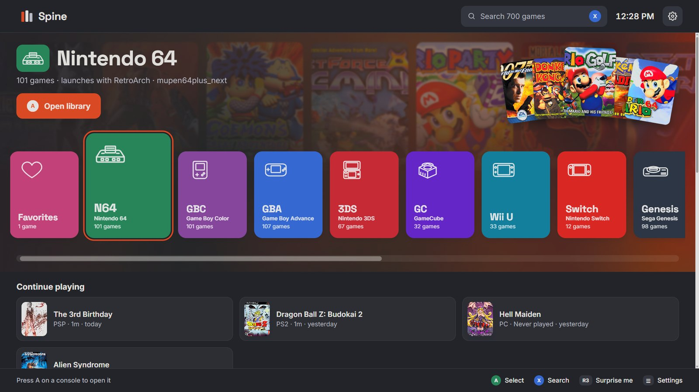
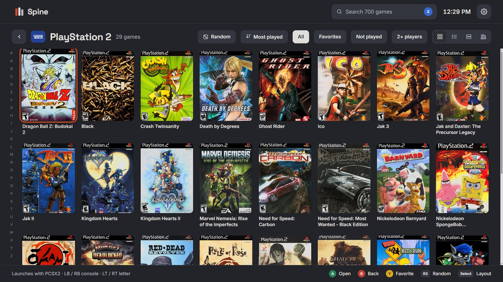
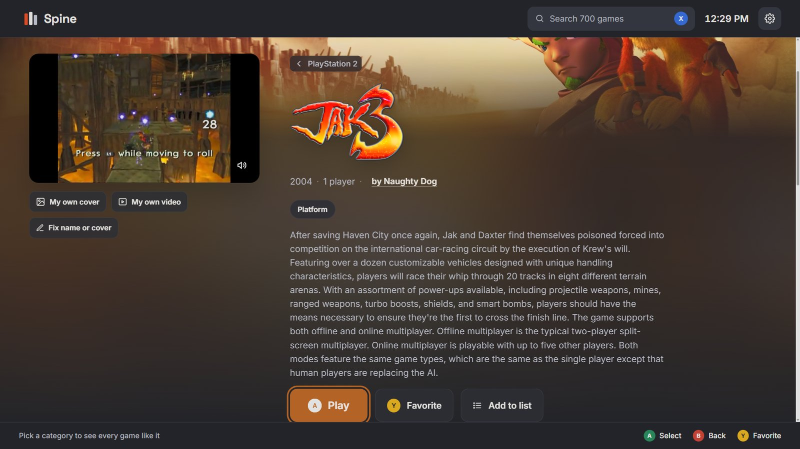
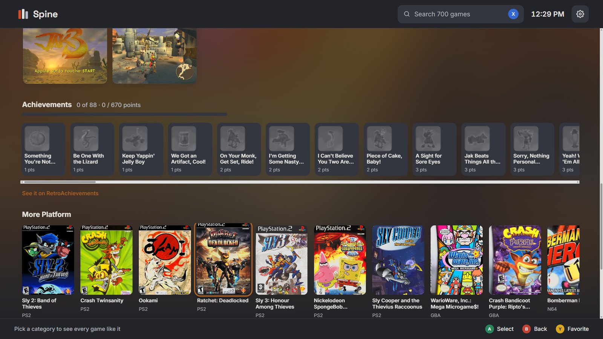
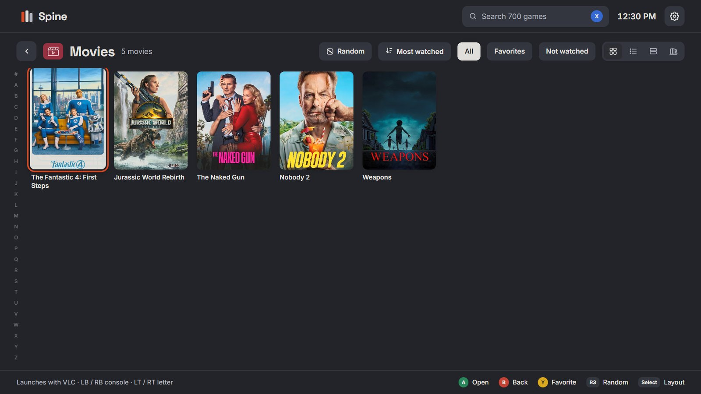
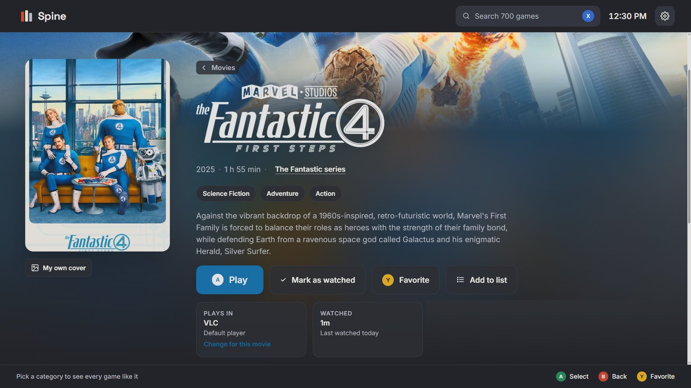
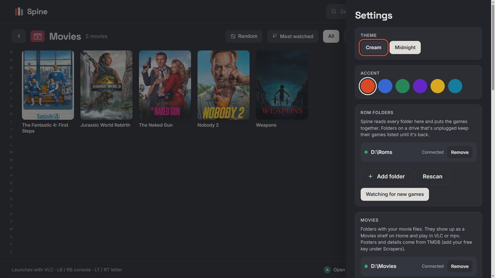

# Spine

A game library for your PC that feels like a console. Point it at your ROM
folder and it sorts every game by console and A–Z, finds box art, details and
trailers, and starts each game with the right emulator. Steam, Epic and GOG
games show up too. Your movies and TV shows can live there too, with posters, episode lists and
resume where you left off. Everything works with a controller.



| | |
|---|---|
|  |  |
| **Every console, A–Z:** box art for each game, four layouts, an A–Z rail. | **Game pages:** trailers, banners, logos and descriptions. |
|  |  |
| **And more:** screenshots, RetroAchievements, "more like this". | **Movies & TV:** posters and details found for you. |
|  |  |
| **Movie pages:** play in VLC or mpv, resume where you stopped. | **Make it yours:** themes, colors, several folders and drives. |

## Get it

**Windows:** download **Spine-Setup.exe** from the latest release on this page
and run it. No admin rights needed; Spine gets a Start menu entry and a desktop
shortcut. (Prefer no installer? Take **Spine.exe** instead and put it in its own
folder. Spine keeps its settings, covers and favorites next to the program.)
Windows 10 or 11.

**Linux:** paste this into a terminal:

```
curl -fsSL https://raw.githubusercontent.com/paperwolf2350-lab/spine/main/install.sh | sh
```

That's it: Spine appears in your app menu. Rather click than type? Download
**Spine-x86_64.AppImage**, then right-click it → Properties →
Permissions → *Allow executing file as program* (or `chmod +x Spine-x86_64.AppImage`),
and double-click it. Spine adds itself to your app menu the first time it runs.
Works on most distributions, including SteamOS and Bazzite. Debian and Ubuntu
users can install **Spine-amd64.deb** instead. Settings and covers live in
`~/.local/share/spine`.

Both update themselves: when a new version is out, Settings → Updates offers it.

Your emulators can be anywhere common: an `Emulators` folder next to your ROMs,
Program Files or AppData on Windows; Flatpaks (Flathub), your distribution's
packages, or AppImages in `~/Applications` (EmuDeck's layout) on Linux.

## What it does

- **Organizes everything:** consoles from folder names, clean titles, duplicates
  merged, updates and DLC attached, several ROM folders and drives, unplugged
  drives remembered. Steam, Epic and GOG games join in (on Linux through Steam and Heroic).
- **Looks good:** covers from libretro, Steam, SteamGridDB and ScreenScraper,
  trailers on game pages, four layouts, themes, a moving cover wall per console.
- **Plays:** the right emulator per console, a different one per game if you
  like, playtime tracking, hold Select + Start to quit back to Spine.
- **Helps:** missing BIOS files named with where they go, links to official
  emulator downloads, fix a wrong name or cover in a few clicks.
- **Movies & TV:** point it at your movie and show folders. Posters, backdrops,
  summaries and episode names come from TMDB (free key). Shows are split into
  seasons; episodes get thumbnails and checkmarks. Plays in VLC or mpv, resumes
  where you stopped (VLC), and a "Continue watching" row picks up the next episode.
- **Extras:** categories you can click ("every Roguelite you own"), your own
  lists, Surprise me, RetroAchievements on game pages.

Spine never ships BIOS files, keys or games. Use dumps of hardware and games
you own.

## Build it yourself

Install Rust (https://rustup.rs) and Visual Studio's C++ build tools, then:

```
cd spine-app
cargo build --release
```

The app is `spine-app` (Tauri 2, plain HTML/CSS/JS interface in `spine-app/ui`).
The library scanning, matching and launching live in `spine-core`, which also
builds a command-line tool, `spine-scan`.

## Releasing

Bump `version` in `spine-app/Cargo.toml` (and `spine-core/Cargo.toml` and
`spine-app/tauri.conf.json` to match) and push to `main`. GitHub Actions
builds Spine.exe, fingerprints it, and publishes release `v<version>`.
